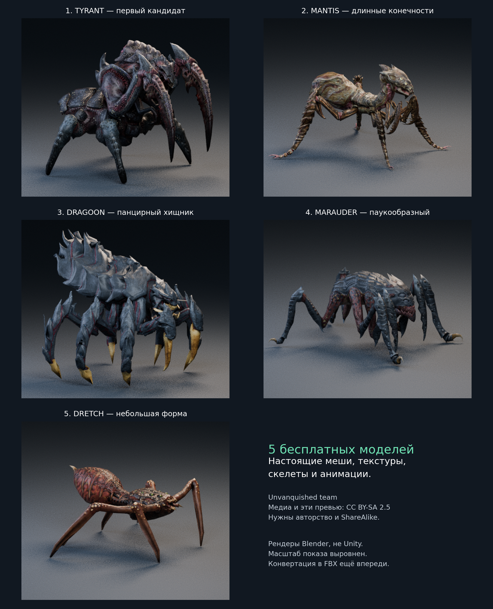

# Пять конкретных бесплатных моделей монстров



Это рендеры **настоящих скачанных моделей Unvanquished**, не картинки выдуманных ассетов.
Скелеты, исходные текстуры diffuse/normal/specular и именованные анимации найдены в IQE-файлах.
Модели ещё не импортированы в Unity: потребуется конвертация IQE в FBX и адаптация URP-материалов.
Наличие скелета/ключей проверено по исходникам; работоспособность всех клипов в Unity не проверена.

| № | Модель | Особенность | Костей | Треугольников | Именованных клипов |
|---|---|---|---:|---:|---:|
| 1 | Tyrant | Массивный панцирный хищник с крупными когтями | 63 | 9 738 | 24 |
| 2 | Mantis | Длинные конечности и силуэт хищного насекомого | 38 | 9 480 | 23 |
| 3 | Dragoon | Бронированное существо с зубастой пастью | 73 | 14 902 | 18 |
| 4 | Marauder | Низкий паукообразный хищник | 57 | 10 010 | 23 |
| 5 | Dretch | Паукообразная форма, самый простой меш набора | 46 | 2 384 | 23 |

Для SILENCE в первую очередь рассмотреть Tyrant, затем Mantis/Dragoon. Все требуют художественной
адаптации под слепое существо: оригинальные головы имеют глаза. Это бесплатная игровая основа,
а не обещание качества киноперсонажа. Выбор модели владельцем ещё не сделан.

## Источник и лицензия

- Авторство, указанное README исходного пакета: [**Unvanquished team**](https://unvanquished.net/about/).
- [Исходники моделей](https://github.com/UnvanquishedAssets/res-players_src.dpkdir),
  закреплённая ревизия записана вместе с хешами и прямыми ссылками каждой модели в inventory.json.
- [Официальный COPYING проекта](https://github.com/Unvanquished/Unvanquished/blob/master/COPYING.txt)
  указывает для медиа **Creative Commons Attribution-ShareAlike 2.5**,
  [текст и условия](https://creativecommons.org/licenses/by-sa/2.5/). Сохранена копия COPYING.
- Рендеры в этой папке — производные изображения моделей: кредит Unvanquished team,
  исходники по ссылкам выше, лицензия рендеров также **CC BY-SA 2.5**. Условия включают указание
  авторства и ShareAlike для производных материалов; перед поставкой ассета нужно сохранить
  относящиеся к нему сведения об авторах/лицензии. Это не CC0.
- Код Unvanquished в игру SILENCE не копировался. Меши/текстуры пока не включены в Assets SILENCE.

## Как получены картинки

Blender 4.3.2 Cycles, 24 samples, одинаковый нейтральный студийный свет, первая поза stand.
Координаты и веса взяты из IQE, исходные diffuse/normal текстуры назначены без рисования новой кожи.
Roughness приближённая постоянная: это не полная копия игрового шейдера Unvanquished.
Масштаб показа нормализован для сравнения форм; родные размеры существ различаются.
Это не скриншоты Unity и не результат проверки готового монстра в SILENCE.

Воспроизведение (Blender и checkout исходного пакета нужны только для рендеров):

```sh
blender -b --python Tools/CreatureArt/render_free_candidates.py -- --source /path/to/res-players_src.dpkdir --output /tmp/creature-previews
```

Это все пять атакующих форм level0–level4 из проверенного исходного набора, а не все
бесплатные монстры в интернете. Страницы большинства магазинов/каталогов здесь по-прежнему
заблокированы HTTP 403; непроверенные товары и цены в подборку не включены.
